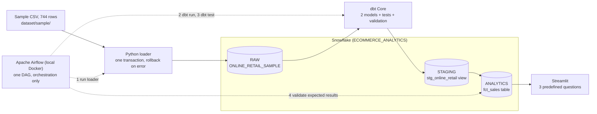

# Pipeline Architecture (college microproject)

Status: the loader, dbt and Streamlit have run against Snowflake and passed their checks. The Airflow DAG started and its ingestion task succeeded, but its `dbt run` task failed on a dbt parse-cache clash that is not fixed yet (see the README). The earlier local PostgreSQL warehouse (`docker-compose.yml`) is kept as a verified fallback and is not part of this path.

## Roles

- **Python loader** (`ingestion/load_sample_to_snowflake.py`) reads the CSV and writes `RAW.ONLINE_RETAIL_SAMPLE`: all eight source columns as text, blanks as NULL, nothing removed. It replaces the existing rows in one transaction, so a rerun never duplicates data, and it rolls back on any error.
- **Snowflake** stores all layers. Three key-pair service users with separate roles: `AIRBYTE_ROLE` (writes `RAW`; the name is historical, it now serves the Python loader), `TRANSFORM_ROLE` (dbt: reads `RAW`, writes `STAGING` and `ANALYTICS`), `READER_ROLE` (Streamlit: read-only on `ANALYTICS`).
- **dbt Core** converts the text columns to numbers and timestamps, applies the cleaning rules in `stg_online_retail` and `fct_sales`, runs the tests, and checks the final results (744 raw rows, 597 valid-sales rows, 72 orders, revenue 10,210.21, 13 months).
- **Airflow** only sequences the steps; it does not store or transform data.
- **Streamlit** answers three fixed questions with fixed read-only queries.

**Why not Airbyte:** Airbyte Cloud was configured first (File source to Snowflake) but could not sync because of an insufficient-credits restriction. The team decided not to add a payment method, so Python ingestion replaced Airbyte. Revision history: BigQuery to PostgreSQL, then Snowflake with Airbyte Cloud, then Python ingestion (all 2026-11-15); see section 18 of [business_problem.md](../documentation/business_problem.md).
