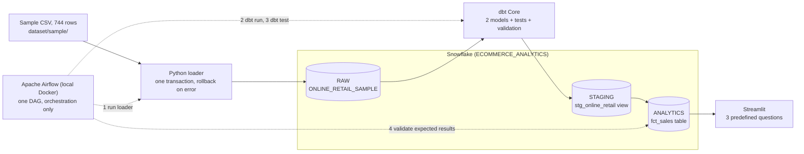

# Pipeline Architecture (college microproject)

Scope: the implemented pipeline processes the 744-row sample; the full 541,909-row UCI dataset was inspected in Phase 2 but is not loaded. Status: the loader, dbt and Streamlit have run against Snowflake and passed their checks. The Airflow DAG ran end to end after dbt's artifacts were isolated in the container (all four tasks passed; see the README). The earlier local PostgreSQL warehouse (`docker-compose.yml`) is kept as a verified fallback and is not part of this path.

## Roles

- **Python loader** (`ingestion/load_sample_to_snowflake.py`) reads the CSV and writes `RAW.ONLINE_RETAIL_SAMPLE`: all eight source columns as text, blanks as NULL, nothing removed. It replaces the existing rows in one transaction, so a rerun never duplicates data, and it rolls back on any error.
- **Snowflake** stores all layers. Three key-pair service users with separate roles: `AIRBYTE_ROLE` (writes `RAW`; the name is historical, it now serves the Python loader), `TRANSFORM_ROLE` (dbt: reads `RAW`, writes `STAGING` and `ANALYTICS`), `READER_ROLE` (Streamlit: read-only on `ANALYTICS`).
- **dbt Core** converts the text columns to numbers and timestamps, applies the cleaning rules in `stg_online_retail` and `fct_sales`, runs the tests, and checks the final results (744 raw rows, 597 valid-sales rows, 72 orders, revenue 10,210.21, 13 months).
- **Airflow** only sequences the steps; it does not store or transform data.
- **Streamlit** answers three fixed questions with fixed read-only queries.

**Why not Airbyte:** Airbyte Cloud ingestion was blocked by a billing restriction. An insufficient-credits message was observed during setup, and the connection was subsequently disabled by Airbyte Cloud due to a billing issue. The project therefore uses Python-based ingestion into Snowflake instead. The team decided not to add a payment method. (Airbyte Cloud was configured first as File source to Snowflake.) Revision history: BigQuery to PostgreSQL, then Snowflake with Airbyte Cloud, then Python ingestion (all 2026-11-15); see section 18 of [business_problem.md](../documentation/business_problem.md).
