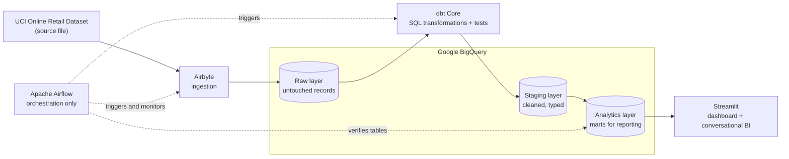

# Pipeline Architecture

Planned architecture. Components are **not yet implemented**; this diagram shows the design only.

## Roles

- **Airbyte** moves source records into the BigQuery raw layer.
- **BigQuery** stores all three layers and executes the SQL.
- **dbt** builds staging and analytics tables and runs data tests.
- **Airflow** only schedules and sequences tasks (ingest, wait, verify, dbt run, dbt test, verify). It does not store or transform data.
- **Streamlit** reads the analytics layer with read-only access.
