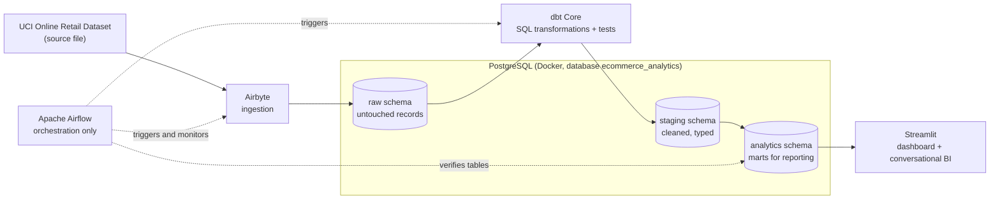

# Pipeline Architecture

Planned architecture. Only the PostgreSQL warehouse container is being set up so far; the other components are **not yet implemented**, and this diagram shows the design only.

## Roles

- **Airbyte** moves source records into the PostgreSQL `raw` schema (role `airbyte_user`, write access to `raw` only).
- **PostgreSQL** stores all three layers and executes the SQL. It runs in Docker on host port 5434.
- **dbt** reads `raw` and builds the `staging` and `analytics` schemas, then runs data tests (role `dbt_user`).
- **Airflow** only schedules and sequences tasks (ingest, wait, verify, dbt run, dbt test, verify). It does not store or transform data.
- **Streamlit** reads the `analytics` schema only, with a read-only role (`streamlit_ro`).

Revision note: BigQuery was replaced by PostgreSQL on 2026-11-15; see section 18 of [business_problem.md](../documentation/business_problem.md).
