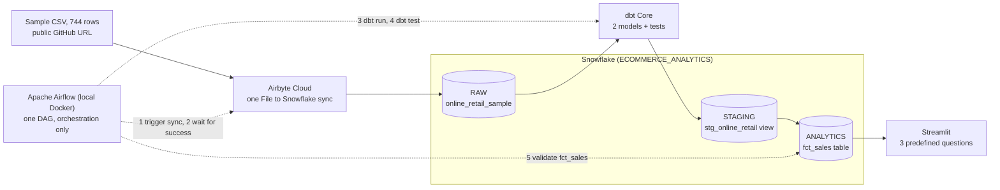

# Pipeline Architecture (college microproject)

Design only. **Nothing here has run yet:** no Airbyte Cloud or Snowflake account exists. The earlier local PostgreSQL warehouse (`docker-compose.yml`) is kept as a verified fallback and is not part of this path.

## Roles

- **Airbyte Cloud** reads the CSV from its public URL and writes it to the Snowflake `RAW` schema (Full Refresh Overwrite). Airflow calls its API (`POST /jobs`, then `GET /jobs/{id}`).
- **Snowflake** stores all layers. Three key-pair service users with separate roles: `AIRBYTE_ROLE` (writes `RAW`), `TRANSFORM_ROLE` (dbt: reads `RAW`, writes `STAGING` and `ANALYTICS`), `READER_ROLE` (Streamlit: read-only on `ANALYTICS`).
- **dbt Core** builds `stg_online_retail` and `fct_sales` and runs the tests.
- **Airflow** only sequences the steps; it does not store or transform data.
- **Streamlit** answers three fixed questions with fixed read-only queries.

Revision history: BigQuery to PostgreSQL (2026-11-15), then to Snowflake with Airbyte Cloud (2026-11-15). See section 18 of [business_problem.md](../documentation/business_problem.md).
